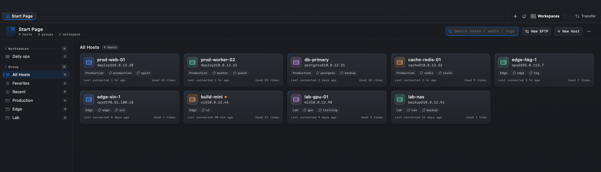

# Tauge

**SSH and SFTP, together, on macOS.**

macOS has a terminal, but no good way to browse a remote server's files next
to it. Tauge is a native Mac app that puts both in one window: open a shell,
open the SFTP pane, and change a config, move a file, or read a log without
switching apps.

[](https://github.com/surgingDandelion/Tauge/actions/workflows/ci.yml)
[](https://github.com/surgingDandelion/Tauge/releases/latest)
[](LICENSE)
[](https://www.apple.com/macos/)

English · [简体中文](README.zh-CN.md)



## Install

Download the latest `Tauge-<version>.dmg` from
[Releases](https://github.com/surgingDandelion/Tauge/releases/latest), drag
Tauge into Applications, and launch it.

Tauge requires macOS 13 Ventura or later and runs on both Apple silicon and
Intel Macs.

Release builds are ad-hoc signed unless the repository is configured with
Developer ID signing and notarisation credentials. If macOS blocks the first
launch, right-click the app and choose **Open**, or follow
[docs/INSTALL.md](docs/INSTALL.md#if-macos-blocks-the-first-launch).

Tauge keeps itself up to date from GitHub Releases. It checks once a day in the
background, shows the release notes, verifies the download, and replaces the
app after it quits. Use **Tauge → Check for Updates…** to check immediately.

Hosts, settings and encrypted credentials live outside the app bundle. The
first launch after the Tauge rename copies the previous catalog and vault into
the current Tauge data directory before opening them.

## Features

### A terminal you can live in

- Tabs, split panes, and drag-to-arrange. Work in one shell or watch several at
  once.
- Find in the scrollback (`⌘F`), copy on select, paste with confirmation, and
  Option as Meta.
- Six colour themes, adjustable font, size, and opacity, plus 10,000 lines of
  scrollback.
- A dropped connection keeps the output on screen and reconnects automatically.
- Optional session logging when you need a record of what happened.
- Startup and explicit one-shot commands are risk-classified. Ordinary commands
  run directly, while privilege, deletion, service, and file changes require a
  confirmation inside Tauge.

### Files next to the shell

- Open an SFTP pane beside any terminal, or a local pane beside a remote one.
  No second app, no dragging files through Downloads.
- Drag files between panes, out to Finder, or in from Finder. Select several
  rows and drag them as one batch.
- Drag between two remote panes to copy server to server without touching your
  local disk.
- Edit small text files in place, change permissions, rename, delete, and create
  folders.
- Transfers can be paused, resumed after a dropped connection, and retried.
  Conflicts can overwrite, skip, rename, or keep the newer file.

### Several servers in one workspace

- A workspace is one tab containing a grid of SSH sessions. Useful when a task
  spans a web server, a database, and a log box.
- Choose a layout and several hosts when creating a workspace. Drag pane edges
  to resize, or double-click a title to maximise a pane.
- Layouts and open panes are restored the next time you launch Tauge.

### Hosts that stay organised

- Nested groups with inherited defaults for user, port, key, proxy, jump host,
  theme, and encoding.
- Favourites, recent hosts, and search by name, address, user, tag, note, or
  pinyin initials.
- Import your existing `~/.ssh/config` or a Termius vault.
- Up to three jump hosts, plus HTTP and SOCKS5 proxies, set per host, per group,
  or globally.

### Quick Open and the small things

- Press `⌘K` anywhere to search hosts, workspaces, and commands in one field;
  `↑`/`↓` pick a row. `↩` connects, `⌘↩` opens the highlighted host as an SFTP
  tab, and each host takes a single row.
- A menu-bar item for opening the window, starting a terminal or SFTP tab, and
  checking transfers.
- English and Simplified Chinese, switchable at runtime.
- In-app updates from GitHub Releases, with release notes before you install.

### Local by default

- Passwords and key passphrases are sealed with AES-256-GCM in Tauge's own
  vault under `~/Library/Application Support/Tauge`, not in the login Keychain, so
  updates and reinstalls never trigger a Keychain prompt. An optional Touch ID
  check gates the app when it opens.
- Host keys are checked on first connection. If a key changes, Tauge blocks the
  connection and shows both fingerprints.
- Password, Ed25519, ECDSA, and RSA authentication.
- No account, no sync service, no analytics, and no crash reporting.

## Build from source

You need macOS 13 or later, the Command Line Tools (`xcode-select --install`),
and network access for the first dependency resolution.

```bash
git clone https://github.com/surgingDandelion/Tauge.git
cd Tauge
swift build --disable-sandbox
./scripts/build-app.sh release
open dist/Tauge.app
```

Commands run through the same Tauge catalog, credential vault and SSH stack.

```bash
swift run --disable-sandbox tauge machines list
swift run --disable-sandbox tauge exec --machine prod-web -- uname -a
swift run --disable-sandbox tauge exec --machine prod-web -- sudo systemctl restart nginx
swift run --disable-sandbox tauge mcp
```

`tauge mcp` speaks the local stdio MCP transport and exposes the authorized
machine list and remote command execution through the same Tauge vault and SSH
stack. The Gateway is a transport adapter and leaves command decisions to the
caller.

`--disable-sandbox` is only needed where `sandbox-exec` is restricted. For a
universal build, the self-check suite, project layout, and localisation notes,
see [CONTRIBUTING.md](CONTRIBUTING.md).

## Current limitations

- `keyboard-interactive` authentication and `ssh-agent` are not supported yet.
- Servers that only offer SHA-1 `ssh-rsa` or `ssh-dss` cannot be reached.
- Encrypted PEM keys are not supported; use the OpenSSH key format.
- Workspaces use a grid plus manual splits rather than an arbitrary nested
  tree, and scrollback is not restored after a relaunch.
- Large remote directories load as one list, and dragging a folder to Finder is
  not supported; use the transfer centre or a second pane.

If one of these blocks you, open an issue with the details.

## Privacy

Tauge has no accounts, analytics, or crash reporting. Hosts, keys, settings, and
transfer history are stored on your Mac. The update check asks GitHub's public
Releases API for the latest version and sends no host, credential, or usage
data; you can turn it off in Settings → General.

App data lives in `~/Library/Application Support/Tauge`, credentials in your
encrypted vault in that same folder, and optional session logs in `~/Logs`.

## Documentation

- [Installing Tauge](docs/INSTALL.md)
- [Building, testing, and contributing](CONTRIBUTING.md)
- [Code signing and notarisation](docs/SIGNING.md)
- [Release process](docs/RELEASING.md)
- [Changelog](CHANGELOG.md)
- [Security policy](SECURITY.md)

## License

[MIT](LICENSE) © 2026 surgingDandelion.

Tauge is built on [SwiftTerm](https://github.com/migueldeicaza/SwiftTerm),
[SwiftNIO SSH](https://github.com/apple/swift-nio-ssh), SwiftNIO,
[swift-crypto](https://github.com/apple/swift-crypto), and
[swift-log](https://github.com/apple/swift-log). See
[THIRD_PARTY_NOTICES.md](THIRD_PARTY_NOTICES.md).
