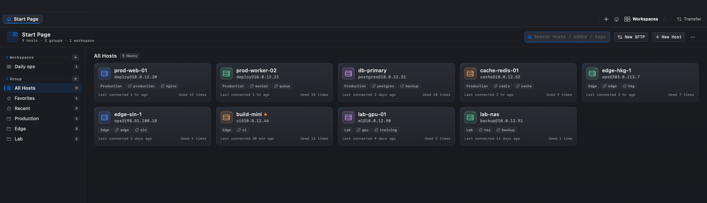

# Tauge

**在 macOS 上，把 SSH 和 SFTP 放在一起。**

macOS 自带终端，但一直没有顺手的方式在终端旁边浏览远程文件。过去要么在终端
和 SFTP 工具之间来回切换，要么先把文件下载到本地再上传。Tauge 是一个原生 Mac
客户端，把终端和文件浏览放进同一个窗口：改配置、传文件、看日志，都不用离开
当前工作。

[](https://github.com/surgingDandelion/Tauge/actions/workflows/ci.yml)
[](https://github.com/surgingDandelion/Tauge/releases/latest)
[](LICENSE)
[](https://www.apple.com/macos/)

[English](README.md) · 简体中文



## 安装

从 [Releases](https://github.com/surgingDandelion/Tauge/releases/latest) 下载
最新的 `Tauge-<version>.dmg`，把 Tauge 拖进「应用程序」，然后打开。

系统要求：macOS 13 Ventura 及以上，Apple 芯片和 Intel Mac 都支持。

当前发布包在未配置 Developer ID 签名和公证凭据时为 ad-hoc 签名。如果 macOS
拦截首次启动，右键点击应用选择「打开」，或参考
[docs/INSTALL.md](docs/INSTALL.md#if-macos-blocks-the-first-launch)。

Tauge 会每天在后台检查 GitHub Release，展示更新说明、校验下载内容，并在退出后
完成替换。也可以随时使用 **Tauge → 检查更新…**。

主机、设置和加密凭据都保存在应用包之外。Tauge 更名后的首次启动会先把旧目录中的
目录数据库和凭据库复制到当前 Tauge 目录，再打开它们。

## 功能

### 一个能一直待着的终端

- 标签页、分屏和拖拽调整。可以只开一个 shell，也可以同时盯几台机器。
- 回滚区查找（`⌘F`）、选中即复制、粘贴确认、Option 作为 Meta。
- 六套配色，字体、字号、透明度可调，回滚缓冲 10,000 行。
- 连接断开时保留屏幕内容，并自动重连。
- 需要留档时可以开启会话日志。
- 连接启动命令和显式一次性命令会先做风险分类。普通命令直接执行，涉及权限提升、删除、服务或文件变更的高危命令会在 Tauge 内弹窗确认。

### 终端旁边的文件

- 在任意终端旁打开 SFTP 窗格，也可以在本地目录和远程目录之间双栏操作。不用
  再开第二个应用，也不用把文件先下载到「下载」文件夹。
- 文件可以在窗格之间拖拽，也可以拖到 Finder 或从 Finder 拖入。支持多选后
  整批拖动。
- 在两个远程窗格之间拖拽，即可服务器到服务器直传，不经过本地磁盘。
- 可以直接编辑较小的文本文件，修改权限、重命名、删除、新建目录。
- 传输支持暂停、断线续传和重试；遇到同名文件可以选择覆盖、跳过、重命名或
  保留较新的那个。

### 一个工作区，多台服务器

- 一个工作区就是一个标签页，里面可以放一组 SSH 会话。适合同时操作 Web
  服务器、数据库和日志机的场景。
- 新建时选择布局和多台主机，之后拖动窗格边缘调整大小，双击标题最大化。
- 布局和打开的窗格会在下次启动时恢复。

### 主机管理

- 支持多层分组，用户、端口、私钥、代理、跳板机、主题和编码都可以继承。
- 收藏、最近使用，以及按名称、地址、用户名、标签、备注或拼音首字母搜索。
- 可以导入现有的 `~/.ssh/config` 或 Termius 保险库。
- 最多三级跳板机，支持 HTTP 和 SOCKS5 代理，可按主机、分组或全局设置。

### Quick Open 和一些细节

- 在任何界面按 `⌘K`，一个输入框同时搜索主机、工作区和命令，`↑`/`↓` 选中一行。
  `↩` 连接，`⌘↩` 把选中的主机开成 SFTP 标签；每台主机只列一行，SFTP 不再重复占位。
- 菜单栏常驻入口，可以打开主窗口、新建终端或 SFTP 标签、查看传输。
- 内置英文和简体中文，设置里即时切换。
- 应用内更新，安装前可以先看更新说明。

### 默认留在本机

- 密码和私钥口令使用 AES-256-GCM 加密，保存在 `~/Library/Application Support/Tauge`
  下 Tauge 自己的凭据库中，不写入登录钥匙串，因此更新或重装不会触发钥匙串授权
  弹窗。可在设置中开启启动时的 Touch ID 解锁。
- 首次连接校验主机密钥。密钥发生变化时会阻止连接，并同时显示新旧指纹。
- 支持密码、Ed25519、ECDSA 和 RSA 认证。
- 没有账号，没有同步服务，没有统计和崩溃上报。

## 命令行与 MCP

Tauge 提供命令行客户端，复用应用的主机目录、加密凭据库和 SSH 连接能力。
命令行参数不会接收密码或私钥。

```bash
tauge machine list
tauge machine list --json
tauge exec --machine prod-web -- uname -a
tauge cp machineA:/var/log/app.log machineB:/tmp/app.log
tauge cp -r machineA:/var/log/app machineB:/tmp/
```

`tauge mcp` 启动本地 stdio MCP 服务。先在 **Tauge → 设置 → 通用 → MCP 通道**
打开开关，再把下面的配置填入 MCP 客户端。

```json
{
  "mcpServers": {
    "tauge": {
      "command": "/usr/local/bin/tauge",
      "args": ["mcp"]
    }
  }
}
```

应用包内包含 `TaugeCLI`。可以在 MCP 设置卡片点击「安装 tauge 命令」，也可以运行
`scripts/install-cli.sh`，把 `tauge` 注册到 `/usr/local/bin` 或 `~/.local/bin`。

## 从源码构建

需要 macOS 13 及以上、Command Line Tools（`xcode-select --install`），以及
首次解析依赖时的网络连接。

```bash
git clone https://github.com/surgingDandelion/Tauge.git
cd Tauge
swift build --disable-sandbox
./scripts/build-app.sh release
open dist/Tauge.app
```

命令行复用 Tauge 的主机目录、加密凭据库和 SSH 连接能力，执行结果直接返回。

```bash
swift build --disable-sandbox --product TaugeCLI
./scripts/install-cli.sh
tauge machine list
tauge exec --machine prod-web -- uname -a
tauge exec --machine prod-web -- sudo systemctl restart nginx
tauge cp machineA:/var/log/app.log machineB:/tmp/app.log
tauge mcp
```

`tauge mcp` 使用本地 stdio MCP 传输，提供授权主机列表和远程命令执行，复用 Tauge 的凭据库与 SSH 连接能力。Gateway 只负责通道，不判断或拦截命令。

安装 Tauge.app 后运行一次 `./scripts/install-cli.sh`，脚本会把 `tauge` 安装到 `/usr/local/bin`。没有写权限时会使用 `~/.local/bin`。之后可以直接使用 `tauge machine list`。

只有在 `sandbox-exec` 受限的环境中才需要 `--disable-sandbox`。通用二进制、
自检、代码结构和本地化说明见 [CONTRIBUTING.md](CONTRIBUTING.md)。

## 目前还不支持

- 暂不支持 `keyboard-interactive` 认证和 `ssh-agent`。
- 只提供 SHA-1 `ssh-rsa` / `ssh-dss` 的老旧服务器无法连接。
- 不支持加密 PEM 私钥，请改用 OpenSSH 格式。
- 工作区是网格加手动分割，不是任意嵌套树；回滚内容不会跨重启保留。
- 大目录会一次性加载；不支持把文件夹直接拖到 Finder，请使用传输中心或第二个
  窗格。

如果其中某项影响到你，欢迎提 Issue 说明场景。

## 隐私

Tauge 没有账号、统计分析或崩溃上报。主机、密钥、设置和传输记录都保存在本机。
更新检查只向 GitHub 的公开 Release API 询问最新版本，不发送主机、凭据或使用
数据，可以在「设置 → 通用」中关闭。

应用数据保存在 `~/Library/Application Support/Tauge`，凭据在同目录的加密凭据库中，
可选的会话日志位于 `~/Logs`。

## 文档

- [安装与首次启动](docs/INSTALL.md)
- [构建、测试与贡献](CONTRIBUTING.md)
- [代码签名与公证](docs/SIGNING.md)
- [发布流程](docs/RELEASING.md)
- [更新日志](CHANGELOG.md)
- [安全策略](SECURITY.md)

## 许可证

[MIT](LICENSE) © 2026 surgingDandelion。

本项目建立在 [SwiftTerm](https://github.com/migueldeicaza/SwiftTerm)、
[SwiftNIO SSH](https://github.com/apple/swift-nio-ssh)、SwiftNIO、
[swift-crypto](https://github.com/apple/swift-crypto) 与
[swift-log](https://github.com/apple/swift-log) 之上，详见
[THIRD_PARTY_NOTICES.md](THIRD_PARTY_NOTICES.md)。
